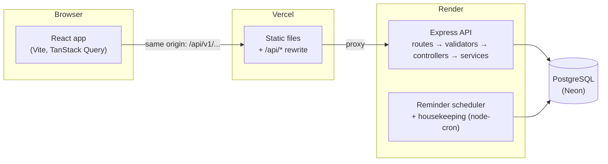

# HabitFlow

Build habits that stick. HabitFlow is a habit tracker: you create recurring habits (every day, chosen weekdays, or "3 times a week"), tick them off in a second, and see streaks, completion rates and your long-term history. Missing a day never earns a red mark or a scolding.

It is a responsive React web app on a Node.js + PostgreSQL REST API. The API is ready for a future mobile app, and the code is SaaS-ready: per-user workspaces and plan limits are built in.

<!-- Screenshots: add images to docs/screenshots/ and link them here, e.g.
  -->
> 📸 *Screenshots coming soon.* The Playwright tests save fresh ones to `frontend/test-results/screens/` on every run.

## Features

- **Habits with flexible schedules:** daily, specific weekdays, or a weekly target, with categories, colours, icons and backfilled start dates.
- **Today view:** a one-tap check-off (instant, even on a slow connection), browsing past days, a progress ring and a 7-day strip.
- **Streaks that are fair:** an unfinished today never breaks a streak, and days a habit isn't scheduled are skipped.
- **Analytics:** completion rates by day, week, habit and category, a 12-month heatmap, and history with notes.
- **Reminders and notifications:** in-app reminders in your own timezone, plus streak milestones.
- **Account:** profile, timezone, password, notification preferences and account deletion.
- **Accessible:**
  - full keyboard support;
  - screen-reader labels and live updates;
  - contrast checked in light and dark mode;
  - respects reduced-motion settings.
- **Secure by default:** server-side sessions in HttpOnly cookies, CSRF protection, rate limits, and strict isolation between users.

## Architecture



In development, Vite's dev server plays the role of Vercel: it proxies `/api` to the API on port 3000. The browser therefore always talks to a single origin, and the session cookie and CSRF token work the same everywhere. Deployment guide: [docs/DEPLOYMENT.md](docs/DEPLOYMENT.md).

| Layer | Technology |
|---|---|
| Frontend | React 19, Vite, React Router 7, TanStack Query 5, Tailwind CSS 4, Recharts, react-hook-form + Zod, Luxon (JavaScript) |
| Backend | Node 20, Express 5, Sequelize 6, PostgreSQL 16, Zod, Luxon, pino, node-cron |
| Tests | Jest + Supertest, Vitest + Testing Library + MSW, Playwright + axe-core |
| Hosting | Vercel (web), Render (API), Neon (database), GitHub Actions (CI) |

## Run it locally (4 commands)

Prerequisites: **Node.js 20+**, **Docker** and Git.

```bash
git clone https://github.com/SundarLogic/HabitFlow.git && cd HabitFlow
node scripts/setup.mjs          # .env files, PostgreSQL in Docker, npm ci, migrations, demo data
npm --prefix backend run dev    # API  → http://localhost:3000/api/v1/health
npm --prefix frontend run dev   # Web  → http://localhost:5173   (in a second terminal)
```

Log in with **demo@habitflow.local / habitflow-demo**, or sign up.

- **Interactive API docs:** http://localhost:3000/api/docs (Swagger UI, development only).
- **Port 5432 already in use?** Set `POSTGRES_PORT` in `.env`, and the same port in `DB_PORT` and `TEST_DATABASE_URL` in `backend/.env`, then run the setup again.

<details>
<summary>The same setup, step by step</summary>

```bash
cp .env.example .env && cp backend/.env.example backend/.env
docker compose up -d --wait            # PostgreSQL 16 with habitflow_dev + habitflow_test
cd backend && npm ci && npm run db:migrate && npm run db:seed && npm run dev
cd frontend && npm ci && npm run dev   # in a second terminal
```

The API checks every environment variable at startup and lists any that are missing or malformed. [backend/.env.example](backend/.env.example) documents each one.
</details>

## Scripts

| Where | Command | What it does |
|---|---|---|
| root | `node scripts/setup.mjs` | One-time local setup (above) |
| root | `docker compose -f docker-compose.prod.yml up --build` | The API's production Docker image plus its own PostgreSQL, on http://localhost:3001 |
| backend | `npm run dev` / `npm start` | API with auto-restart / without it |
| backend | `npm run start:prod` | Production start: migrations, then the server (Render uses this) |
| backend | `npm run db:migrate` · `db:migrate:undo` | Apply / undo the latest database migration |
| backend | `npm run db:seed` · `db:seed:plans` | Plans + demo data (development) / plans only (safe in production) |
| backend | `npm run perf:seed` · `perf:bench` | Large dataset, then EXPLAIN plans and p95 latency per endpoint |
| frontend | `npm run dev` · `build` · `preview` | Dev server · production build to `dist/` · serve the build with the production security headers |
| both | `npm run lint` · `format` · `format:check` | ESLint and Prettier |

The full command list is in [CLAUDE.md §7](CLAUDE.md).

## Testing

```bash
npm --prefix backend test                 # Jest: unit + API tests on habitflow_test (Docker must be running)
npm --prefix backend run test:coverage    # same, and enforces coverage (services/domain ≥ 85 %, streak & analytics engines 100 %)
npm --prefix frontend test                # Vitest + Testing Library + MSW (no backend needed)
npm --prefix frontend run test:e2e        # Playwright: every user story + axe accessibility checks, desktop / Pixel 5 / 375 px
```

The first E2E run needs `npx playwright install chromium` in `frontend/`.

GitHub Actions runs all of these, plus `npm audit`, on every push and pull request (`.github/workflows/ci.yml`). What was verified before release, and the known limitations, are in [docs/QA_REPORT.md](docs/QA_REPORT.md).

## Project structure

```
.
├── backend/                 Express API
│   ├── src/
│   │   ├── routes/          URL → middleware → controller wiring (+ Swagger UI in development)
│   │   ├── validators/      Zod schemas for body / params / query
│   │   ├── controllers/     HTTP only: read input, call one service, shape the response
│   │   ├── services/        business logic and transactions (workspace-scoped queries)
│   │   ├── domain/          pure rules: dates, schedules, streaks, analytics (no I/O)
│   │   ├── models/          Sequelize models; migrations/ and seeders/ (.cjs)
│   │   ├── middleware/      auth, CSRF, workspace, validation, errors, logging, rate limits
│   │   ├── jobs/            reminder scheduler + housekeeping (node-cron)
│   │   ├── observability/   slow-query logging, error tracking (Sentry-ready)
│   │   └── config/          validated environment, database, logger, auth settings
│   ├── tests/               unit/, integration/, db/ (Jest)
│   ├── scripts/perf/        performance dataset + benchmark
│   └── Dockerfile           production image
├── frontend/                React app
│   ├── src/                 pages/, features/, components/ui/, lib/, services/apiClient.js
│   ├── e2e/                 Playwright specs
│   └── vercel.json          Vercel rewrites, caching and security headers
├── docs/                    PRD, API reference + OpenAPI, ERD, streak rules, decisions,
│                            deployment, QA report, mobile readiness, roadmap
├── .github/workflows/ci.yml GitHub Actions
├── render.yaml              Render Blueprint (API)
├── docker-compose.yml       local PostgreSQL (dev + test databases)
├── docker-compose.prod.yml  production-like local stack (API image + PostgreSQL)
└── CLAUDE.md                architecture, conventions, commands: start here to contribute
```

## Documentation

| Document | What's in it |
|---|---|
| [CLAUDE.md](CLAUDE.md) | How the code is organised and the rules every change follows |
| [docs/HabitFlow_PRD.md](docs/HabitFlow_PRD.md) | Product requirements |
| [docs/API.md](docs/API.md) · [openapi.yaml](docs/openapi.yaml) | Every endpoint, with examples and error codes |
| [docs/STREAK_RULES.md](docs/STREAK_RULES.md) | Exactly how streaks and completion rates are computed |
| [docs/ERD.md](docs/ERD.md) | Database schema |
| [docs/DECISIONS.md](docs/DECISIONS.md) | Architecture decision records |
| [docs/DEPLOYMENT.md](docs/DEPLOYMENT.md) | Step-by-step deployment to Neon, Render and Vercel |
| [docs/QA_REPORT.md](docs/QA_REPORT.md) | Release testing: accessibility, security, performance |
| [docs/MOBILE_READINESS.md](docs/MOBILE_READINESS.md) | How a React Native client will use this API |
| [docs/ROADMAP_NOTES.md](docs/ROADMAP_NOTES.md) | Deferred features and where they plug in |
