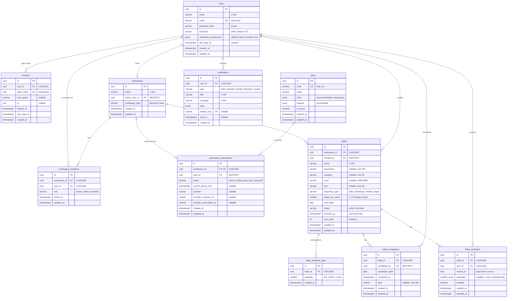

# HabitFlow — Entity Relationship Diagram

The database schema as built by the migrations in [backend/src/migrations](../backend/src/migrations). Business rules behind the schema are in [CLAUDE.md](../CLAUDE.md) §3.1. Decisions are in [DECISIONS.md](DECISIONS.md) (ADR-024 to ADR-028).

All primary keys are UUIDs (`gen_random_uuid()`, pgcrypto). Timestamps are `TIMESTAMPTZ` stored in UTC. `DATE` columns are calendar days in the user's timezone. Enum-like columns are `VARCHAR` with a named `CHECK` constraint.

## Constraints and indexes

| Table | Unique | Checks | Other indexes |
|---|---|---|---|
| users | `email` | email is lowercase; name 1–100; timezone non-empty; preferences is an object | — |
| sessions | `token_hash` | token_hash is 64 lowercase hex chars | `user_id`, `expires_at` |
| plans | `code` | code is `lower_snake_case`; limits/features are objects | — |
| workspaces | one `personal` per owner (partial unique index) | type ∈ personal, team; name 1–100 | `owner_user_id` |
| workspace_members | `(workspace_id, user_id)` | role ∈ owner, admin, member | `user_id` |
| workspace_subscriptions | `workspace_id` | status ∈ active, trialing, past_due, canceled | `plan_id` |
| habits | — | frequency_type valid; `target_per_week` 1–7 when weekly_target, NULL otherwise; status valid; `archived_at` set exactly when archived; text lengths; color `#RRGGBB` | `(workspace_id, status)`, `created_by` |
| habit_schedule_days | `(habit_id, weekday)` | weekday 1–7 | — |
| habit_completions | `(habit_id, completed_by, completion_date)` | note ≤ 280 | `(habit_id, completion_date)`, `(completed_by, completion_date)` |
| habit_reminders | `(habit_id, user_id, remind_at)` | weekdays NULL or non-empty subset of 1–7 | `enabled`, `user_id` |
| notifications | `dedupe_key` (NULLs allowed) | type valid; title 1–120; message 1–500; data is an object | `(user_id, read_at, created_at DESC)`, `created_at` |

## Delete behaviour

- **CASCADE**: deleting a workspace removes its members, subscription and habits. Deleting a habit removes its schedule days, completions and reminders. Deleting a user removes their sessions, memberships, reminders and notifications.
- **RESTRICT**: a user who still owns a workspace (`workspaces.owner_user_id`), created habits (`habits.created_by`) or completions (`habit_completions.completed_by`) can't be deleted directly. Account deletion (not in first release) must delete the personal workspace first, which cascades away that user's habits and history. A plan with subscriptions can't be deleted.
